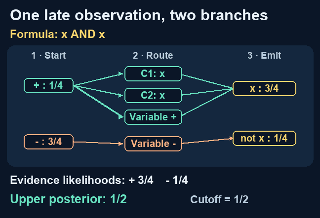

# The complexity of strong-extension posterior smoothing

What can a later observation tell us about an earlier hidden state when each probability row can vary within its own set? Deciding whether the **largest attainable posterior reaches one half is NP-complete**, even with three hidden times, one final binary observation and strictly positive local probabilities. The same hardness holds for exceeding one half, and the corresponding universal comparisons are coNP-complete.

[Paper PDF](paper/manuscript.pdf) · [LaTeX source](paper/manuscript.tex) · [Catalog Q432](https://github.com/10m-u/open-problems-catalog/blob/ca8d4d44ba3db527f19f28928c240168f545ecfe/problems/mathematics/probability-stochastic-processes-part-1.md#q432) · [Original complexity question](https://doi.org/10.1613/jair.4355)

## Why the branches must share literal rows

In the unsmoothed examples, the plus branch starts with probability $1/4$ and sends mass to three units. The minus branch sends its mass to a single variable unit. Both use the same two literal emission rows. At the most favorable endpoint choice for $x\land x$, the branches' evidence likelihoods are $3/4$ and $1/4$, making the prior odds become equal posterior odds. For $x\land\neg x$, at least one clause unit misses the high endpoint. The exact upper posterior drops to $7/16$.

[Download the offline explorer ZIP](https://raw.githubusercontent.com/DannyExperiments/strong-extension-posterior-smoothing/v1.0.0/visualization/strong-extension-posterior-smoothing-explorer.zip) · [Worked examples and rendering guide](visualization/README.md)

## Proof and earlier work

The reduction turns a 3-CNF into three hidden time layers. Every variable's pair of units forces opposite emission endpoints, and each clause unit must find a high literal. A rational score gap remains after all entries are made positive. For membership, a witness names one feasible rational vertex row for each local polytope. Two forward passes verify the posterior exactly.

Prior work gives exact algorithms for fully binary polytrees and current or final hidden-state queries. The hard construction has a growing hidden alphabet and a query before the observed time. [Source and literature audit](audits/public_safe_reports/LITERATURE_AUDIT.md) · [Exact scope](CLAIM_SCOPE_AND_LIMITATIONS.md)

## Replay and citation

The [replay](REPRODUCIBILITY.md) checks exact endpoint models and directly compares each of two single-state signs after positive row mixing. [Review status](STATUS.md) · [Research disclosure](AI_DISCLOSURE.md)

DannyExperiments is the preferred citation identity. [Release v1.0.0](https://github.com/DannyExperiments/strong-extension-posterior-smoothing/releases/tag/v1.0.0) · [Version DOI](https://doi.org/10.5281/zenodo.24570844) · [Citation metadata](CITATION.cff)

## Lean verification

A normalized finite mixture of rational emissions bounded by an upper endpoint attains that endpoint exactly when all positive-weight emissions attain it. This is the support implication used when recovering a truth assignment from the threshold gadget. The full posterior model, real-valued credal rows, the reduction and its complexity bounds are in the paper. [Lean source and replay](formalization/README.md)
